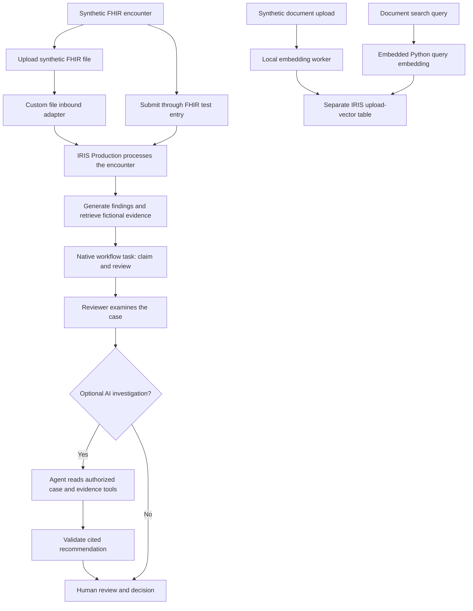
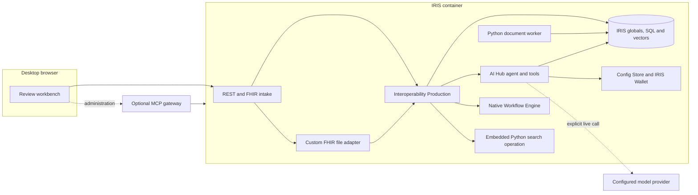

<p align="center">
  
</p>

# Medical Insurance Audit Evidence Assistant

[中文说明](README.zh-CN.md) | English

Medical Insurance Audit Evidence Assistant is a desktop demonstration for exploring how a hospital review team can receive encounter data, identify review items, inspect evidence and record human decisions. It brings an IRIS interoperability Production, vector search, an optional AI investigation and an operations workbench into one application.

> **Scope:** The supplied encounters, rules and evidence are synthetic. The bundled evidence is fictional and is not an insurance policy. The system does not make legal or clinical decisions or automatically deny claims. Do not enter real patient data.

## Features

| Feature | What it does |
| --- | --- |
| FHIR test entry | Submits sample FHIR Bundles to the local demonstration endpoint, including duplicate-order and renal-function scenarios. |
| FHIR file intake | Uploads a synthetic JSON file through a custom inbound adapter; displays file status, recorded business stages and the associated case. |
| Audit tasks | Creates native Workflow Engine tasks for findings; reviewers can claim and complete them with a recorded decision. |
| Knowledge Evidence Library | Keyword search over two labelled fictional evidence snippets; case-review evidence is matched automatically by IRIS vector search. |
| AI investigation | On explicit request, uses AI Hub and restricted case/evidence tools to prepare a cited recommendation for human review. A model configuration is required. |
| Document vector library | Accepts synthetic TXT, Markdown and DOCX files, generates embeddings locally and stores them in a separate IRIS vector table. Uploaded documents can be searched in the document library; they are not included in the separate fictional-policy search or AI evidence tools. |
| Operations | Displays system overview, event history, recorded application stages and the embedded IRIS Production management page. |
| MCP and AI settings | Provides model configuration and, after optional gateway setup, MCP service status, call logs and client-token management. |

The included policy-like texts and vectors are demonstration fixtures: their 512-dimensional vectors are hand-constructed, so their similarity values do not establish semantic relevance or policy validity. AI output is a recommendation, and missing configuration or failed validation is reported as a failure.

## Technical highlights

- **Custom interoperability adapter:** `HD.FHIRFileAdapter` extends IRIS `Ens.InboundAdapter` to send completed FHIR files into the Production. It deduplicates content, retains original files and rate-limits failed retries. The workbench shows file status and the associated event.
- **Native human workflow:** Audit findings enter the IRIS Workflow Engine for reviewers to claim and decide. Synchronization issues and uncertain dispatch outcomes remain available for human investigation.
- **AI Hub with restricted tools:** An explicitly requested investigation uses an Agent and authorized tools for case and fictional evidence, validates the recommendation and citations, and leaves the decision to a human. A model provider must be configured; a visible interface does not prove a model call occurred.
- **Vector Search and Embedded Python:** Fictional evidence uses IRIS Vector Search. Uploaded documents have a separate vector store; a Production operation uses Embedded Python and the same model to embed document-search queries.
- **Reproducible deployment:** Docker Compose configures the application and persistent volume; the package is available from the public ZPM registry and also supports installation from local source. Both paths initialize the demo resources.

## Technology

| Layer | Technology and role |
| --- | --- |
| Runtime and deployment | InterSystems IRIS Community AI Hub EAP build 154; Docker Compose creates the IRIS instance and persistent volume. |
| Interoperability and workflow | `HD.Production` connects FHIR intake, routing, audit, native Workflow Engine tasks and AI-review components. |
| AI | IRIS AI Hub `%AI.Agent`, authorized case and evidence tools, output validation, Config Store and IRIS Wallet. Live model calls require a separately configured provider. |
| Storage and retrieval | IRIS globals and SQL; IRIS Vector Search with `VECTOR_COSINE` for fictional fixtures; a separate `HD.UploadedVectors` table for uploaded documents. |
| Embeddings | A separate Python worker encodes uploaded documents. For document search, a single IRIS Production operation runs Embedded Python to encode queries using the same ONNX model. |
| Interface and integration | Desktop HTML/CSS/JavaScript workbench, REST endpoints and an optional local MCP gateway. |

## Business workflow



A workflow task for a new event is terminal after completion; historical events without workflow markers retain the legacy review behavior. The upload path is independent: uploaded documents are not automatically used by the fictional-evidence search. The flow view displays recorded application stages, not a complete native IRIS message trace.

## System architecture



The external provider is only contacted for an explicitly initiated live investigation. Core IRIS health does not guarantee that the embedding worker has finished downloading and loading its dependencies.

## Prerequisites

- Docker and Docker Compose, with sufficient memory and disk for a separate IRIS instance and its persistent volume.
- **InterSystems IRIS Community AI Hub EAP build `2026.3.0AI.154.0`**. Obtain the appropriate architecture from the [InterSystems AI Hub Early Access portal](https://evaluation.intersystems.com/Eval/early-access/AIHub). This repository does not distribute the image.
- Internet access on the first start if document vectorization is enabled: Python dependencies and a pinned ONNX model are downloaded. In the ARM64 test, the model occupied about 91 MiB and the Python environment 188 MiB, excluding temporary download caches.
- A desktop browser. Host Python is only needed for optional MCP setup or the Python verification commands; Node.js is only needed for JavaScript tests.

The clean-install and document-upload checks described below were run on ARM64. An x64 clean installation has not yet been verified.

## Install and start

Run commands from the repository root. After downloading the build 154 image for your platform, load it and retag it if necessary:

```sh
docker load -i /path/to/iris-ai-hub-build-154.tar.gz
docker image ls
# Replace with the repository:tag displayed by docker image ls, if different.
docker tag <loaded-image-name> iris-community:2026.3.0AI.154.0

docker compose up -d
docker compose ps
docker compose logs --tail=30 iris
```

Wait for the `iris` service to report `healthy`. On a new volume, Compose initializes IRIS, compiles the application, imports fictional vector fixtures, starts the Production and creates a random password for the local `medreview` administrator. Startup does **not** make an online LLM call.

Open <http://127.0.0.1:52884/med-audit/> and sign in as **medreview**. Retrieve its password locally:

```sh
docker compose exec -T iris cat /durable/iris/private/med-audit-reviewer-password
```

Docker Compose defaults `MED_AUDIT_DEFAULT_LOGIN_NO_CHANGE=1`: once per data volume, it removes the first-login password-change requirement for `_SYSTEM` only. A fresh image accepts the IRIS default `_SYSTEM` / `SYS`; existing passwords are preserved and never reset. Set this option to `0` to skip initialization. This option is intended for a local demo.

The generated password and data persist across restarts. The account has IRIS administrative privileges and the HTTP port is bound to localhost. The embedded Production page signs in automatically with the demo administrator. Do not expose this demo publicly without an independent security review.

To select another host port, set `MED_AUDIT_PORT` before running Compose. `docker compose down` stops the project and preserves its volume. `docker compose down -v` deletes this project's data and generated credentials.

## Install with ZPM / IPM

In addition to Docker Compose, you can use ZPM (IPM) in the `USER` namespace of a **dedicated** IRIS Community AI Hub EAP build 154 instance. Enable Interoperability in the namespace and use an administrator account. Install the latest public release with:

```objectscript
USER>zpm "install med-insurance-audit"
USER>set sc=##class(HD.PackageSetup).Start() if $system.Status.IsError(sc) { do $system.Status.DisplayError(sc) }
```

The public ZPM registry already contains this project. For the dependency-isolation correction described here, confirm that ZPM resolves version `1.0.1` or later. To install this checkout directly instead, make the source path readable by the IRIS process and run:

```objectscript
USER>zpm "load /path/to/med-insurance-audit"
USER>set sc=##class(HD.PackageSetup).Start() if $system.Status.IsError(sc) { do $system.Status.DisplayError(sc) }
```

The package creates the vector table before compiling static SQL, then copies the web assets, tools, and synthetic fixtures into the IRIS manager directory. The start method creates or updates `/med-audit` and `/med-audit-admin` and starts `HD.Production`; run it only in a dedicated instance. Sign in with an existing IRIS administrator account and complete any required initial password change. Open `http://host:port/med-audit/`.

ZPM installs the application and fixtures but does not download the embedding model, install the separate upload worker's Python dependencies, or configure an MCP gateway. Use the Compose setup above or provide equivalent prerequisites for document upload. The worker-only dependencies are kept in `requirements/upload-worker.txt`, outside the root path that IPM automatically processes.

## FHIR file inbound adapter

After signing in, open **FHIR File Intake** to upload a test JSON file, inspect its status and recorded stages, and open the associated case. The flow is not a complete IRIS message trace.

`FHIRFileIntake` is a custom `Ens.InboundAdapter` in the Production. Every three seconds it scans `/durable/iris/private/fhir-inbox/` for UTF-8 FHIR Bundle files up to 1 MiB and sends them through the existing audit workflow. Compose creates the directory; for other deployments, create it with read access for the IRIS user or configure `Inbox` in the Production. Producers must finish writing a temporary file and atomically rename it in the same directory to `*.ready.json`. Original files are retained; identical content is deduplicated by SHA-256 and failed files are retained and retried periodically. This demo endpoint is for synthetic data and is not a complete FHIR server.

For example, submit the synthetic fixture inside the Compose container:

```bash
docker compose exec -T iris sh -c 'cp /workspace/samples/encounter-bundle.json /durable/iris/private/fhir-inbox/example.tmp && mv /durable/iris/private/fhir-inbox/example.tmp /durable/iris/private/fhir-inbox/example.ready.json'
```

Results appear in the existing case list. Files are not automatically deleted; operators must arrange their own retention and cleanup. Do not place real patient files in public source directories or images.

## Getting started: no LLM key required

1. Open **FHIR Test** and select a synthetic scenario, such as duplicate medication orders. Submit it to IRIS. The batch action submits three independent synthetic cases.
2. Open **Audit Tasks** and select the new case. Review its findings, application-stage flow and evidence. A retrieved fixture is labelled `synthetic-demo`; it has no official policy URL or effective date.
3. In **Workflow tasks**, claim the finding task, select a decision and enter a reason to complete it. A case with findings can be closed only after its workflow tasks are complete; cases without findings may be reviewed directly. The system does not change orders or automatically reject a claim.
4. Open **Event Monitor** or **IRIS Production** to inspect the corresponding application status. The embedded Production page signs in automatically with the demo administrator.
5. Optionally open **File Vector Library**, upload a small synthetic UTF-8 `.txt` file and wait for the job to show **Imported**. The uploaded text and embeddings go to the separate upload-vector table. Use **Search uploaded documents** to find matching chunks; results require human verification.

This walkthrough exercises FHIR, evidence retrieval and manual review without a model key. It is not a replay of a successful AI investigation; without model configuration a live investigation cannot succeed.

## Optional live AI investigation

The default image contains no LLM API key. Configure an available provider from the authenticated **AI Settings** page:

1. Add a configuration, select a provider, and enter the exact model ID and endpoint for your account and region. The UI offers presets including Qwen, OpenAI, DeepSeek and custom OpenAI-compatible providers; availability depends on your account and network.
2. Enter your own key in the UI. Enter the planning rates required for a cloud profile, save it, and select **Use for investigations**. The key is stored in IRIS Wallet; saving validates configuration format but does not verify the key or call the model.
3. Open a synthetic case and explicitly select **Start AI investigation**. Inspect the recorded investigation stages, tool evidence and validated result. A missing configuration, provider failure, invalid output or stale case is reported as a failure rather than a successful investigation.

**Costs:** online calls can incur provider charges. The application allows at most 50 investigation attempts per UTC day; this is **not** a monetary budget, and no cumulative spending cap is enforced. Do not include keys in the repository. Currently the project configures keys through AI Settings/IRIS Wallet; an environment-variable key setup is **not implemented**. A fresh-install live AI call has not yet been verified for this distribution.

## Document upload and model setup

After core initialization, the upload worker starts in the IRIS container. It installs the dependencies in `requirements/upload-worker.txt`, downloads the pinned [ONNX conversion and tokenizer](https://modelscope.cn/models/lyf219/bge-small-zh-v1.5-onnx), verifies their SHA-256 hashes and caches them in the volume. `healthy` applies to core IRIS and can appear before the worker is ready.

```sh
docker compose logs --tail=50 iris
```

Look for `UPLOAD_WORKER_STARTING`; the upload page also shows a worker heartbeat. If installation or download fails, logs contain `UPLOAD_SETUP_DEPENDENCIES_FAILED` or `UPLOAD_SETUP_MODEL_FAILED`, and setup retries every 30 seconds. The core workbench remains usable. The worker supports UTF-8 TXT, Markdown and DOCX up to 2 MB. Search uses Embedded Python in a single Production operation, matching only uploads with the same model hash. Uploaded content is not automatically a policy authority. Do not run the legacy host worker simultaneously for the same instance.

To disable automatic preparation and the worker, set `MED_AUDIT_ENABLE_UPLOAD_WORKER=0` before `docker compose up -d`.

## Optional MCP gateway

Once IRIS is healthy, run:

```sh
python3 scripts/setup-mcp.py
docker compose --profile mcp up -d mcp-gateway
```

The endpoint is <http://127.0.0.1:52885/mcp>. The setup creates private configuration under ignored `artifacts/mcp-private/`; do not commit it. Use the workbench MCP tabs to manage tokens and inspect status and logs. MCP is separate from the upload worker.

## Verification and troubleshooting

With the service healthy, run the core test without a paid model call:

```sh
python3 -m unittest discover -s tests -p test_clean_e2e.py -v
node --test tests/test_agent_flow.js tests/test_flow_model.js
```

For an isolated upload test after the worker is ready:

```sh
MED_AUDIT_TEST_UPLOAD=1 python3 -m unittest discover -s tests -p test_upload_e2e.py -v
MED_AUDIT_TEST_UPLOAD_SEARCH=1 python3 -m unittest discover -s tests -p test_upload_search_e2e.py -v
MED_AUDIT_TEST_WORKFLOW=1 python3 -m unittest discover -s tests -p test_workflow_e2e.py -v
```

These tests create synthetic records in the configured Compose project. To test another project/port, set `COMPOSE_PROJECT_NAME` and `CLEAN_DEMO_BASE` consistently. The complete Python suite also needs optional embedding dependencies; it is not required for starting the workbench.

If IRIS is not healthy, check `docker compose logs iris` and confirm the build 154 image and available resources. If upload jobs remain queued, check the worker heartbeat and download logs; core health alone does not confirm worker readiness. If an AI investigation fails, check the active profile, credentials and provider connectivity; saving a profile does not test a live call.

On ARM64, a fresh volume, FHIR and fixture retrieval, an isolated MCP flow, a synthetic document upload, vector insertion and restart/cache reuse were tested. This does not establish x64 support, production security or reproducible live AI acceptance in a new installation.

## Project structure

```text
.
├── module.xml                    # ZPM / IPM package manifest
├── preload/                      # Vector table initialization before package compilation
├── compose.yaml                  # IRIS, persistent volume and optional MCP gateway
├── requirements/
│   └── upload-worker.txt          # Container upload worker's Python dependencies
├── README.md / README.zh-CN.md   # English and Chinese documentation
├── LICENSE                       # MIT license
├── samples/                      # Fictional evidence, query, rule and FHIR fixtures
├── scripts/                      # Startup, model download and optional MCP setup
├── src/
│   ├── HD/                       # IRIS ObjectScript application and Production
│   │   └── MCP/                  # MCP tools, access, service, tokens and monitoring
│   └── national/                 # Empty placeholder; tests may use temporary files
├── tests/                        # Automated checks; not required to run the app
├── tools/                        # Local embedding and document upload worker
└── web/                          # Desktop UI, static assets and sample FHIR data
```

`artifacts/` may be created locally for optional MCP configuration and other private runtime files; it is Git-ignored. The upload model, Python environment and database data are stored in the Docker volume, not committed to this directory.

## Licenses and limits

- Source and original fixtures: [MIT License](LICENSE). IRIS EAP images, model weights, actual policies, private credentials and runtime data are not included in the repository.
- Real policy provenance, dates and permissions require separate review. The project is a synthetic demonstration, not a complete FHIR server or a production medical compliance system.
- Workflow task completion uses persisted intent and retry when synchronization is interrupted; dispatch outcomes that are unknown require manual inspection of the native messages before recovery. A task completed externally without matching application review history is marked `REVIEW_MISMATCH` and blocks case closure; it requires manual investigation. Embedded Python search has not yet undergone long-duration load testing.
