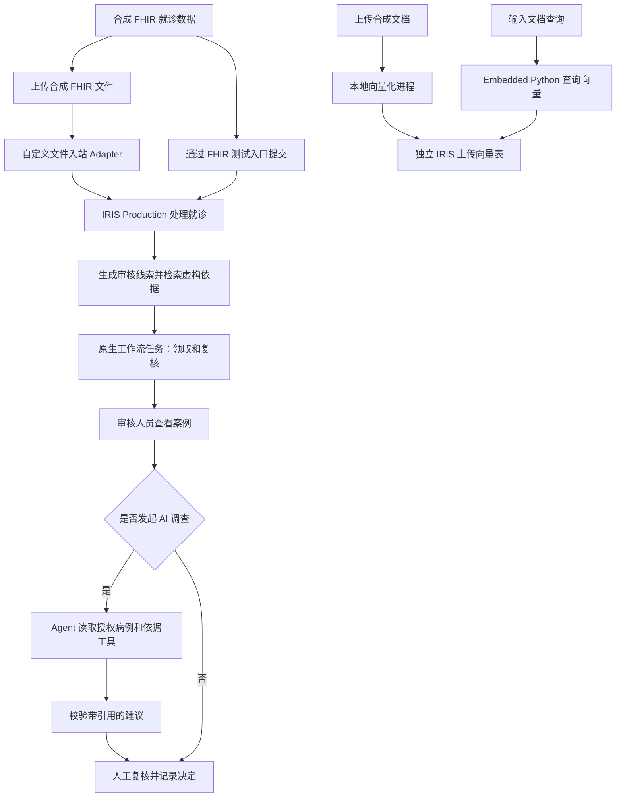
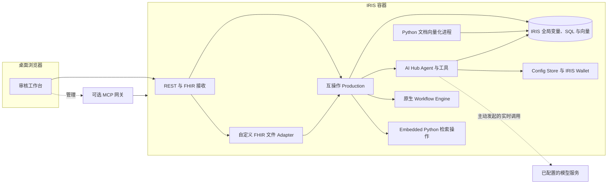

<p align="center">
  
</p>

# 医保智能审核与证据助手

[English](README.md) | 中文

医保智能审核与证据助手是一个面向桌面端的演示系统，帮助使用者了解医院审核人员如何接收就诊数据、发现待核查线索、查看依据并记录人工判断。系统将 IRIS 互操作流程、向量检索、可选 AI 调查和运行管理工作台整合在一起。

> **使用范围：** 随附的就诊、规则和依据均为合成数据；内置依据是虚构样例，不是真实医保政策。系统不作法律或临床判断，也不自动拒付。请勿输入真实患者数据。

## 功能介绍

| 功能 | 作用 |
| --- | --- |
| FHIR 测试入口 | 向本地演示端点提交合成 FHIR Bundle，包含重复医嘱、肾功能线索等场景。 |
| FHIR 文件接入 | 上传合成 JSON 文件，由自定义入站 Adapter 接收；查看文件状态、已记录的业务阶段及关联案例。 |
| 审核任务 | 为审核线索创建原生 Workflow Engine 任务，审核人员领取后记录处理决定并完成任务。 |
| 知识依据库 | 按关键词检索两条明确标注的虚构依据样例；案例审核时的依据则由 IRIS 向量检索自动匹配。 |
| AI 调查 | 审核人员主动发起后，AI Hub 使用受限的病例和依据工具生成带引用的建议，供人工复核；需要配置模型服务。 |
| 文件向量库 | 接收合成 TXT、Markdown、DOCX 文档，本地生成向量并写入独立的 IRIS 向量表；可在文件向量库中单独检索；不会自动加入虚构政策检索或 AI 依据工具。 |
| 运行管理 | 查看系统概览、事件历史、已记录的应用阶段及嵌入的 IRIS Production 管理页面。 |
| MCP 与 AI 设置 | 配置模型；完成可选网关初始化后，可查看 MCP 服务状态、调用日志并管理客户端令牌。 |

内置的政策式文本及其 512 维向量只是演示样例，向量为手工构造，相似度不能证明语义相关性或政策有效性。AI 结果只是待人工复核的建议，配置缺失或校验失败会显示为失败。

## 技术亮点

- **自定义互操作 Adapter：** `HD.FHIRFileAdapter` 继承 IRIS `Ens.InboundAdapter`，将已完成投递的 FHIR 文件送入 Production；支持内容去重、保留原文件及失败后限频重试。工作台可查看文件状态与关联事件。
- **原生人工工作流：** 审核线索进入 IRIS Workflow Engine，由审核人员领取并记录决定；同步异常与派发结果不确定时保留人工核查入口。
- **AI Hub 与受限工具：** 按需发起调查，由 Agent 调用授权工具获取病例与演示依据，校验建议及引用后供人工复核。真实模型调用需要配置服务，不能仅凭界面判断已调用模型。
- **向量检索与 Embedded Python：** 虚构依据使用 IRIS Vector Search；上传文档单独生成并存储向量，检索时由 Production 操作中的 Embedded Python 使用同一模型生成查询向量。
- **可复现部署：** Docker Compose 配置应用及持久卷；ZPM / IPM 模块支持从本地源码安装并初始化演示资源。ZPM 包尚未发布到公共注册表，详见下方安装说明。

## 技术组成

| 层次 | 技术与作用 |
| --- | --- |
| 运行与部署 | InterSystems IRIS Community AI Hub EAP build 154；Docker Compose 创建 IRIS 实例和持久数据卷。 |
| 互操作与工作流 | `HD.Production` 连接 FHIR 接收、路由、审核、原生 Workflow Engine 任务与 AI 调查组件。 |
| AI | IRIS AI Hub `%AI.Agent`、授权病例与依据工具、输出校验、Config Store 和 IRIS Wallet；实时调用需要另行配置模型服务。 |
| 存储与检索 | IRIS 全局变量与 SQL；使用 `VECTOR_COSINE` 检索虚构样例；上传文档写入独立的 `HD.UploadedVectors` 表。 |
| 向量化 | 独立 Python 进程对上传文档编码；文档检索使用 IRIS Production 单进程操作中的 Embedded Python，以同一 ONNX 模型生成查询向量。 |
| 界面与集成 | HTML/CSS/JavaScript 桌面工作台、REST 接口和可选本地 MCP 网关。 |

## 业务流程



新事件的任务完成后进入终态；历史未标记事件仍保留旧复核行为。上传流程与审核依据检索相互独立：上传文件不会自动进入内置虚构依据检索。流程图页面展示应用已记录的阶段，不代表完整 IRIS 原生消息轨迹。

## 系统架构



只有主动发起实时 AI 调查时才会访问外部模型服务。IRIS 核心健康状态不代表向量化进程已完成依赖和模型准备。

## 环境要求

- Docker 和 Docker Compose，以及足够运行独立 IRIS 实例和持久数据卷的内存、磁盘空间。
- **InterSystems IRIS Community AI Hub EAP `2026.3.0AI.154.0` 镜像**。从 [InterSystems AI Hub Early Access 门户](https://evaluation.intersystems.com/Eval/early-access/AIHub)下载与机器架构匹配的镜像。本仓库不分发该镜像。
- 如启用文件向量化，首次启动需要联网下载 Python 依赖与固定版本 ONNX 模型。ARM64 测试中模型约占 91 MiB、Python 环境约占 188 MiB，未计临时下载缓存。
- 桌面浏览器。宿主机 Python 仅用于可选 MCP 初始化或 Python 验证命令；Node.js 仅用于 JavaScript 测试。

本文列出的干净安装及文件上传验收使用 ARM64 环境，x64 干净安装尚未验证。

## 安装与启动

以下命令在仓库根目录执行。下载适合当前架构的 build 154 镜像后，加载并按需重新标记：

```sh
docker load -i /path/to/iris-ai-hub-build-154.tar.gz
docker image ls
# 如名称不同，将下方占位符替换为上一步显示的镜像名和标签。
docker tag <loaded-image-name> iris-community:2026.3.0AI.154.0

docker compose up -d
docker compose ps
docker compose logs --tail=30 iris
```

等待 `iris` 服务状态为 `healthy`。使用新数据卷时，Compose 会初始化 IRIS、编译应用、导入虚构向量样例、启动 Production，并为本地演示管理员 `medreview` 生成随机密码。启动过程不会调用在线大模型。

打开 <http://127.0.0.1:52884/med-audit/>，使用 **medreview** 登录。密码通过本机命令获取：

```sh
docker compose exec -T iris cat /durable/iris/private/med-audit-reviewer-password
```

Docker Compose 默认设置 `MED_AUDIT_DEFAULT_LOGIN_NO_CHANGE=1`：每个数据卷首次初始化时，仅取消 `_SYSTEM` 首次登录必须修改密码的要求。全新镜像可使用 IRIS 默认账号 `_SYSTEM` / `SYS`；已有数据卷保留原密码，不会重置。设置为 `0` 可跳过此初始化。该选项仅适合本机演示。

密码与数据保存在卷中，重启后仍然有效。该账号具有 IRIS 管理权限，HTTP 端口仅绑定本机。嵌入的 Production 页面使用演示管理员自动登录；在完成独立安全审查前请勿公开暴露演示环境。

如需更改宿主机端口，可在运行 Compose 前设置 `MED_AUDIT_PORT`。`docker compose down` 会停止项目并保留数据卷；`docker compose down -v` 会删除本项目数据与生成的登录凭据。

## ZPM / IPM 安装

除 Docker Compose 外，也可在**专用** IRIS Community AI Hub EAP build 154 的 `USER` 命名空间使用已安装的 ZPM（IPM）。目标命名空间须启用 Interoperability；需有系统管理权限。以下命令中的目录应是目标 IRIS 进程可读取的项目目录：

```objectscript
USER>zpm "load /path/to/med-insurance-audit"
USER>set sc=##class(HD.PackageSetup).Start() if $system.Status.IsError(sc) { do $system.Status.DisplayError(sc) }
```

包预加载器在编译前检查并创建向量表；网页、工具与合成样本复制到 IRIS 管理目录。启动方法会创建或更新 `/med-audit`、`/med-audit-admin` 并启动 `HD.Production`，因此只应在专用实例执行。使用实例现有 IRIS 管理员账号登录；若要求首次修改密码，请先按 IRIS 提示完成。地址为 `http://主机:端口/med-audit/`。

ZPM 只安装应用及样例，不会下载嵌入模型、安装独立上传工作进程的 Python 依赖或配置 MCP 网关。需要完整文档上传与模型准备时，使用上面的 Compose 方案，或自行完成等效环境配置。该包目前尚未发布到公开 ZPM 注册表，不能使用 `zpm "install med-insurance-audit"` 从公共源安装。

## FHIR 文件入站 Adapter

登录后进入侧栏“FHIR 文件接入”，可上传测试 JSON、查看处理状态与已记录的业务阶段，并跳转到对应案例。流程图不代表完整 IRIS 消息追踪。

`FHIRFileIntake` 是 Production 中的自定义 `Ens.InboundAdapter`，每 3 秒扫描 `/durable/iris/private/fhir-inbox/`。Compose 启动时会创建该目录；其他部署须先创建目录并授予 IRIS 运行账号读权限，也可在 Production 配置中调整 `Inbox`。它接受最大 1 MiB 的 UTF-8 FHIR Bundle 文件，调用现有审核流程。投递方应先写临时文件，写完后在同一目录中原子重命名为 `*.ready.json`，防止处理未写完的内容。原文件保留；相同内容按 SHA-256 去重，处理失败文件保留并间隔重试。该演示接口仅使用合成数据，不应视为完整 FHIR Server。

例如，在运行中的 Compose 容器内投递项目样例（文件名仅供演示）：

```bash
docker compose exec -T iris sh -c 'cp /workspace/samples/encounter-bundle.json /durable/iris/private/fhir-inbox/example.tmp && mv /durable/iris/private/fhir-inbox/example.tmp /durable/iris/private/fhir-inbox/example.ready.json'
```

文件处理结果进入现有案例列表；原文件不会自动删除，应由部署方制定归档和清理方式。不要在公开目录或镜像中放入真实患者文件。

## 快速体验：无需大模型密钥

1. 打开 **FHIR 测试入口**，选择合成场景，例如重复医嘱，然后提交到 IRIS。批量操作会提交三个独立合成案例。
2. 打开 **审核任务**，进入新案例，查看审核线索、应用阶段流程和依据。检索到的样例标记为 `synthetic-demo`，不含官方政策链接或生效日期。
3. 在 **工作流任务**中领取线索任务，选择处理决定、填写理由并完成。有线索的案例须先完成全部任务才能结案；无线索案例可以直接复核。系统不会修改医嘱或自动拒付。
4. 打开 **事件监控** 或 **IRIS Production** 查看应用运行情况。嵌入的 Production 页面使用演示管理员自动登录。
5. 可选：打开 **文件向量库**，上传少量不含真实数据的 UTF-8 `.txt` 文件，等待任务显示已导入。文本和向量写入独立的上传向量表；使用 **检索上传文档** 可查询对应片段，结果需人工核实。

以上流程无需大模型密钥，可展示 FHIR、依据检索与人工复核；它不是成功 AI 调查的回放。未配置模型时，实时 AI 调查无法成功完成。

## 可选：真实 AI 调查

默认镜像不包含大模型 API 密钥。登录后在 **AI 设置**中配置自己可用的服务：

1. 新建配置，选择服务商，填写账号和地区对应的准确模型 ID 与接口地址。界面提供 Qwen、OpenAI、DeepSeek、自定义 OpenAI 兼容接口等预设；实际可用性取决于账号和网络。
2. 在页面输入自己的密钥，并按云模型配置要求填写规划费率，保存后选择 **Use for investigations / 用于调查**。密钥保存在 IRIS Wallet。保存只校验配置格式，不验证密钥，也不调用模型。
3. 打开一个合成案例，主动点击 **发起 AI 调查**，查看已记录的调查阶段、工具依据和校验结果。缺少配置、服务商调用失败、输出无效或案例已变化时，系统会显示失败，不会伪装成成功。

**费用：** 在线模型调用可能产生服务商费用。系统每个 UTC 日最多接受 100 次调查尝试，但这**不是金额预算**，目前没有强制累计费用上限。不要把密钥提交到仓库。项目当前通过 AI 设置和 IRIS Wallet 配置密钥，**尚未实现环境变量传入密钥**。公开候选版尚未完成新装环境的实时 AI 调用验收。

## 文件上传与模型准备

核心初始化后，上传工作进程在 IRIS 容器内启动：安装 `requirements.txt` 中的依赖，下载固定版本的 [ONNX 转换模型及分词器](https://modelscope.cn/models/lyf219/bge-small-zh-v1.5-onnx)，校验 SHA-256 并缓存到数据卷。`healthy` 表示核心 IRIS 已就绪，不代表工作进程已经准备完毕。

```sh
docker compose logs --tail=50 iris
```

日志出现 `UPLOAD_WORKER_STARTING` 后工作进程开始运行，文件向量库页面也会显示心跳。安装或下载失败时日志会显示 `UPLOAD_SETUP_DEPENDENCIES_FAILED` 或 `UPLOAD_SETUP_MODEL_FAILED`，并每 30 秒重试；核心工作台仍可使用。支持 UTF-8 TXT、Markdown 和 DOCX，单文件不超过 2 MB。检索查询通过 Production 单进程操作运行 Embedded Python，只比较同模型指纹的上传向量；上传内容不会自动成为政策依据。不要同时为同一实例启动旧的宿主机工作进程。

如需关闭自动准备与工作进程，在运行 `docker compose up -d` 前设置 `MED_AUDIT_ENABLE_UPLOAD_WORKER=0`。

## 可选：MCP 网关

IRIS 健康后执行：

```sh
python3 scripts/setup-mcp.py
docker compose --profile mcp up -d mcp-gateway
```

本机端点为 <http://127.0.0.1:52885/mcp>。初始化会在被 Git 忽略的 `artifacts/mcp-private/` 下生成私有配置，请勿提交。可在工作台的 MCP 标签页管理令牌并查看状态和日志。MCP 与上传工作进程相互独立。

## 验证与故障排查

服务健康后，可运行不调用付费模型的核心测试：

```sh
python3 -m unittest discover -s tests -p test_clean_e2e.py -v
node --test tests/test_agent_flow.js tests/test_flow_model.js
```

工作进程就绪后，可在隔离环境验证上传：

```sh
MED_AUDIT_TEST_UPLOAD=1 python3 -m unittest discover -s tests -p test_upload_e2e.py -v
MED_AUDIT_TEST_UPLOAD_SEARCH=1 python3 -m unittest discover -s tests -p test_upload_search_e2e.py -v
MED_AUDIT_TEST_WORKFLOW=1 python3 -m unittest discover -s tests -p test_workflow_e2e.py -v
```

测试会在所配置的 Compose 项目中创建合成记录。如果使用不同项目或端口，请一致设置 `COMPOSE_PROJECT_NAME` 和 `CLEAN_DEMO_BASE`。完整 Python 测试套件还需要可选嵌入依赖，启动工作台不要求宿主机安装这些依赖。

如果 IRIS 未健康，请查看 `docker compose logs iris`，检查 build 154 镜像及可用资源。上传任务持续排队时，检查工作进程心跳和下载日志；核心健康状态不能代表工作进程就绪。AI 调查失败时，检查当前配置、密钥和服务商连接；保存配置不会验证在线调用。

ARM64 环境已验证新卷启动、FHIR 与虚构样例检索、隔离 MCP 流程、合成文件上传、向量入库以及重启后缓存复用。这些结果不能证明 x64 兼容、生产安全性或新装环境下的真实 AI 调用可复现。

## 项目目录说明

```text
.
├── module.xml                    # ZPM / IPM 包清单
├── preload/                      # 包安装前的向量表初始化
├── compose.yaml                  # IRIS、持久数据卷和可选 MCP 网关的配置
├── requirements.txt       # 容器内上传向量工作进程的 Python 依赖
├── README.md / README.zh-CN.md   # 英文和中文说明
├── LICENSE                       # 项目许可证（MIT）
├── samples/                      # 虚构依据、查询、规则及 FHIR 样例
├── scripts/                      # 启动、模型下载及可选 MCP 初始化脚本
├── src/
│   ├── HD/                       # IRIS ObjectScript 应用及 Production
│   │   └── MCP/                  # MCP 工具、权限、服务、令牌与监控
│   └── national/                 # 空目录占位；部分测试使用临时文件
├── tests/                        # 自动化验证代码，系统运行不依赖此目录
├── tools/                        # 本地向量化及文档上传工作进程
└── web/                          # 桌面界面、静态资源及 FHIR 示例
```

可选 MCP 配置等私有运行文件可能在本机生成于 `artifacts/`，该目录已被 Git 忽略。上传模型、Python 环境和数据库数据存放于 Docker 数据卷，不提交到此目录。

## 许可与限制

- 源码和原创样例采用 [MIT 许可证](LICENSE)。仓库不包含 IRIS EAP 镜像、模型权重、真实政策、私有凭据和运行数据。
- 真实政策的来源、生效日期和许可需要单独核查。本项目是合成数据演示，并非完整 FHIR Server 或可直接用于生产的医保合规系统。
- 任务完成采用持久意图和重试处理同步中断；派发结果未知时须人工核查原生消息，不会盲目重发。若任务在外部完成但缺少一致的应用审核历史，系统标记 `REVIEW_MISMATCH` 并阻止结案，需人工核查。Embedded Python 检索尚未进行长时间负载测试。
